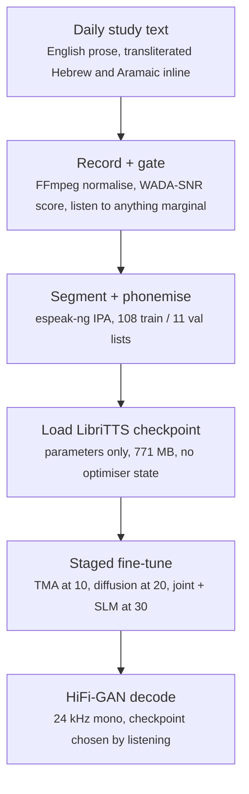

# StyleTTS 2 Fine-Tune: Long-Form Narration Voice

A single-speaker narration voice built by full fine-tuning of StyleTTS 2, for a daily Torah-study publication whose English text is dense with transliterated Hebrew and Aramaic. Corpus construction under an SNR gate, a staged 100-epoch training run on rented GPU, and acceptance on an 8 min 41 s continuous generation rather than on cherry-picked clips.

**Built by** [Darshan Tiwari](https://digitb.tech) (DigitB) · **Year:** Jan 2025 · **Full case study:** https://digitb.tech/case-study/hebrew-tts/

> This repository documents the system: problem, architecture, model choices
> and production setup. Source code is not published here.

## Problem
The publication ships a new English-language study piece every day, each about ten to eleven minutes read aloud. Recording a human narrator daily does not scale. The text is ordinary English prose except that it is saturated with transliterated Hebrew and Aramaic, Rambam, Moshiach, teshuvah, mitzvah, sichah, farbrengen, which the English grapheme-to-phoneme front end has never seen and will happily mangle. Two further constraints made this harder than a stock voice clone: the corpus that could be obtained was twelve minutes, not the one-and-a-half to two hours specified; and the failure mode that actually disqualifies a narration voice is drift over minutes, which no short-sample demo will reveal.

## Data
Source audio was scored before it was trusted: every candidate clip was normalised to 16 kHz mono via FFmpeg and run through WADA-SNR blind signal-to-noise estimation in a Colab notebook, with per-file scores listed next to an inline player so anything marginal could be heard rather than guessed at. What survived became 119 single-speaker clips at 24 kHz mono 16-bit, 12.4 minutes in total, median 5.4 s, range 1.6-14.0 s, split 108 train / 11 validation. Transcripts are not stored as text: each clip is paired with an espeak-ng IPA phoneme string carrying stress marks, in the pipe-delimited wav|phonemes|speaker_id format the trainer reads. A separate 141,433-line pool of phonemised LibriTTS train-clean-360 text supplies out-of-distribution sentences for the adversarial stage. Clips under the configured 50-frame minimum were dropped rather than padded.

## Architecture
PL-BERT encodes the phoneme sequence; a style diffusion module (3 transformer layers, 8 heads, 64 head-features, 10% embedding mask probability) samples a 128-dimensional style vector; duration and F0/energy predictors condition the acoustic path; a HiFi-GAN decoder produces 24 kHz waveform; and WavLM supplies an adversarial naturalness signal. Mel features are 80-bin at n_fft 2048, win 1200, hop 300. The fine-tune loads pretrained weights parameters-only, so no optimiser state carries over from the English run. The objective is a weighted sum dominated by the mel term at 5.0 and the CE term at 20.0, with duration, F0, style, monotonic-alignment, norm, sequence-to-sequence, diffusion and SLM terms all at 1.0. Training is staged, and the schedule is the load-bearing decision: monotonic alignment enters at epoch 10, style diffusion at epoch 20, the joint objective and SLM adversarial stage at epoch 30. Enabling everything from step zero on a corpus this size collapses the model.

## Models evaluated
| Model | Result | Why |
|---|---|---|
| StyleTTS 2 (full fine-tune) | kept | Full fine-tune from the LibriTTS checkpoint, 771 MB in, 2.25 GB out including optimiser state |
| PL-BERT (phoneme-level BERT) | kept | 12 layers, 768 hidden, 178-token phoneme vocabulary, pretrained 1M steps on English Wikipedia |
| HiFi-GAN decoder | kept | Upsample rates 10-5-3-2, product 300, exactly the mel hop length, the decoder reconstructs the frame rate it was given |
| WavLM base+ (SLM discriminator) | kept | 13 layers at 16 kHz, providing the adversarial naturalness signal in the final stage |
| JDC pitch extractor | kept | F0 supervision; without the lambda_F0 term the intonation contour flattens within a few epochs |
| ASR-based aligner | kept | 80-mel input, 256 hidden, phased in at TMA_epoch 10 rather than from step zero |
| VALL-E / one-shot codec cloning | discarded | Clones identity from seconds of audio, but holding one identity across eleven continuous minutes is exactly what it does not promise |
| YourTTS (zero-shot adaptation) | discarded | The cheap route for a single target speaker; documented speaker-similarity ceiling is below what daily narration needs |
| VITS | discarded | No pretrained checkpoint matching the target acoustic conditions, which removes the only reason the tiny corpus works |
| Training from scratch | discarded | 12.4 minutes of audio. The pretrained checkpoint is carrying the entire prosody prior |

## Production
Two machines, two jobs. Corpus preparation ran in Google Colab on a T4, FFmpeg normalisation, WADA-SNR scoring, manual listening, because it is I/O-bound and interactive. Training ran on a rented RunPod GPU through JupyterLab, batch size 3, max sequence length 500, 36 steps per epoch. The full 100-epoch second-stage run took 6 hours 9 minutes wall clock. TensorBoard event files were written throughout; the 118 MB event file is the audio previews logged per validation pass, which is what actually gets listened to. Checkpoints were written every 50 epochs, and inference was driven from a notebook harness that reads the highest-numbered checkpoint and synthesises held-out sentences for A/B comparison. Output is 24 kHz mono.

## Results
- **corpus:** 119 clips, 12.4 min, SNR-gated
- **longest clean run:** 8 min 41 s in one pass, no stitching

## Stack
Python / PyTorch, StyleTTS 2, PL-BERT, HiFi-GAN, WavLM (SLM adversarial), JDC pitch extraction, espeak-ng / phonemizer, NLTK, CUDA, RunPod (GPU training), Google Colab (corpus prep), JupyterLab, TensorBoard, Hugging Face Transformers, FFmpeg / WADA-SNR

## Contact
Architecture reviews, builds and fixes: darshan@digitb.tech · https://digitb.tech
