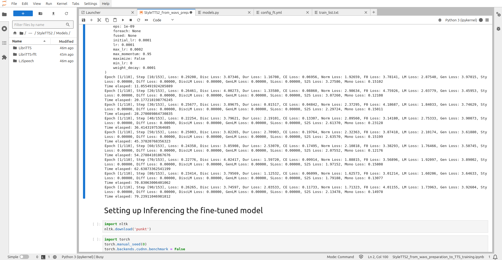

# Fine-tuning StyleTTS 2 for long-form narration from a very small single-speaker corpus

A research write-up. **Author:** [Darshan Tiwari](https://digitb.tech) (DigitB) · **Date:** Jan 2025 · **Full case study:** https://digitb.tech/case-study/hebrew-tts/

> This repository is a write-up of an experiment, not a product. It contains the documentation, one training configuration and a small helper script. It does not contain audio, model weights, checkpoints or the narrator's text.

## Research question

Can a pretrained StyleTTS 2 checkpoint be fully fine-tuned on **12.4 minutes** of clean single-speaker audio, a tenth of the 1.5 to 2 hours the intake specification asked for, and still hold one voice, one pace and one intonation style across an **eleven-minute continuous generation**?

Two details make the question harder than a stock voice clone. The target text is English prose saturated with transliterated Hebrew and Aramaic words (Rambam, Moshiach, teshuvah, mitzvah, farbrengen) that the English grapheme-to-phoneme front end has no rules for. And the failure that disqualifies a narration voice is drift over minutes, which no short demo clip reveals.

## Method

The base is the public StyleTTS 2 LibriTTS checkpoint (upstream code: [yl4579/StyleTTS2](https://github.com/yl4579/StyleTTS2), MIT, not copied here). The fine-tune is a full second-stage run that loads weights only, so no optimiser state carries over from the English run.

- **Text side.** PL-BERT encodes an espeak-ng IPA phoneme sequence. Because the encoder is phoneme-level, an out-of-vocabulary loanword is still representable.
- **Style.** A diffusion module samples a 128-dimensional style vector instead of fixing it, which is what stops delivery flattening.
- **Acoustic path.** Duration and F0/energy predictors, a HiFi-GAN decoder at 24 kHz, and a WavLM base+ discriminator as an adversarial naturalness signal.
- **Staging is the load-bearing decision.** Monotonic alignment enters at epoch 10, style diffusion at epoch 20, the joint objective and SLM adversarial stage at epoch 30. Switching everything on from step zero on a corpus this size collapses the model.
- **Loss weights.** Mel 5.0, cross-entropy 20.0, all other terms 1.0. The adversarial stage is throttled (2% of batches, every 10 iterations, sequences of 400 to 500 frames, scale 0.01, divergence threshold 5) so a discriminator that starts winning cannot drag the generator down.

The shipped configuration is in [`code/configs/config_ft.yml`](code/configs/config_ft.yml). Detail: [docs/architecture.md](docs/architecture.md).

## Data specification

| Property | Value |
|---|---|
| Clips | 119 (108 train, 11 validation) |
| Total duration | 12.4 min |
| Clip length | median 5.4 s, range 1.6 to 14.0 s |
| Format | 24 kHz, mono, 16-bit PCM, one speaker |
| Transcript form | espeak-ng IPA with stress marks, `wav|phonemes|speaker_id` |
| Minimum length | 50 frames, shorter clips dropped, never padded |
| Out-of-distribution text | 141,433 phonemised LibriTTS train-clean-360 lines for the adversarial stage |

Every candidate clip was converted to 16 kHz mono with FFmpeg and scored with WADA-SNR (blind SNR estimation, no clean reference) next to an inline player, so marginal files were listened to rather than guessed at. Detail: [docs/data.md](docs/data.md).

## Training setup and schedule

- Corpus preparation in Google Colab on a T4 (I/O-bound and interactive).
- Training on a rented RunPod GPU through JupyterLab: batch size 3, max sequence length 500, 36 steps per epoch.
- Optimiser: lr 1e-4, PL-BERT lr 1e-5, fine-tune lr 1e-4, weight decay 1e-4.
- Two runs on 10 January 2025. First stage: 200 epochs, validation loss 0.895 to 0.555 (best 0.542 at epoch 189). Second stage: 100 epochs, validation loss 0.416 to 0.370, **6 h 9 min** wall clock (best 0.361 at epoch 68, not saved).
- Checkpoints every 50 epochs; the final checkpoint was chosen by listening, not by loss. Detail: [docs/production.md](docs/production.md).

The style, diffusion and SLM terms read 0.00000 in epoch 1. That is the schedule, not a bug.

## Results (as stated on digitb.tech)

- **Corpus:** 119 clips, 12.4 min, SNR-gated.
- **Longest clean run:** 8 min 41 s generated in one pass, no stitching. This was the acceptance test, chosen because style wander, identity drift, collapse toward monotone and pitch resets per paragraph only appear over minutes.
- Validation loss stopped being informative by about epoch 40 while audio kept improving, so checkpoints were compared by listening, A/B, on held-out sentences.

Result detail and the alternatives considered: [docs/models.md](docs/models.md).

## Limitations

- The corpus is 12.4 minutes, not the specified 1.5 to 2 hours. The result is for one speaker and one recording condition.
- Pronunciation is not linguistically correct Hebrew. espeak-ng's English rules cannot produce the right sounds, and the training data has no Hebrew characters or guttural phonemes. What the model learns is to say English approximations **consistently**, in one voice, at the prosodic weight the narrator gives them.
- The best validation loss (0.361, epoch 68) fell between 50-epoch saves and was never kept. The saved 0.370 checkpoint is within listening noise, but the save interval should have been tighter.
- No listening panel. Acceptance was the author's listening to one long continuous generation; UTMOS and NISQA are named as the intended no-reference checks. No numbers from them are reported here.
- The fine-tuned checkpoint is 2.25 GB because it carries optimiser state. Serving would first need a weights-only export.

## Related research

- [StyleTTS 2: Towards Human-Level Text-to-Speech](https://arxiv.org/abs/2306.07691) and [StyleTTS](https://arxiv.org/abs/2205.15439) (Li et al.), the method and its lineage.
- PL-BERT, HiFi-GAN, WavLM, LibriTTS, Glow-TTS, FastSpeech 2, VITS, VALL-E, NaturalSpeech 2, YourTTS, UTMOS and NISQA, with links and the role each played, in [REFERENCES.md](REFERENCES.md).

## Related research by DigitB

Sibling work on image synthesis: [Chimera Studio](https://digitb.tech/case-study/chimera-studio/).

## Repository contents

| Path | Contents |
|---|---|
| `docs/architecture.md` | Components, staging schedule, data flow |
| `docs/data.md` | Corpus, SNR gate, transcript format, preprocessing |
| `docs/models.md` | Models kept and discarded, evaluation method and results |
| `docs/production.md` | Compute, run timings, checkpoints, serving notes |
| `docs/figures/` | Two screenshots: training run, Colab SNR routine |
| `code/tools/rename_clips.py` | Sequential clip renaming helper |
| `code/configs/config_ft.yml` | Second-stage fine-tuning configuration (relative paths) |
| `code/notebooks/StyleTTS2_Full_Fine-Tuning.ipynb` | Data preparation, training and synthesis notebook (outputs cleared) |
| `code/notebooks/inference.ipynb` | Inference notebook (outputs cleared) |
| `code/notebooks/test.ipynb` | Transcript extraction, subtitle-to-label conversion and clip renaming utilities (outputs cleared) |
| `REFERENCES.md` | Papers, models, tools |

### Running the code

No credentials or environment variables are required. Install the upstream [yl4579/StyleTTS2](https://github.com/yl4579/StyleTTS2) requirements (not copied here), place the prepared 24 kHz clips and train/validation lists where `config_ft.yml` points, then run the fine-tuning notebook on a GPU (Colab or a rented instance) or train with the upstream `train_finetune.py --config_path code/configs/config_ft.yml`. The sample text in the synthesis cell is a placeholder.

Contact: darshan@digitb.tech · https://digitb.tech
