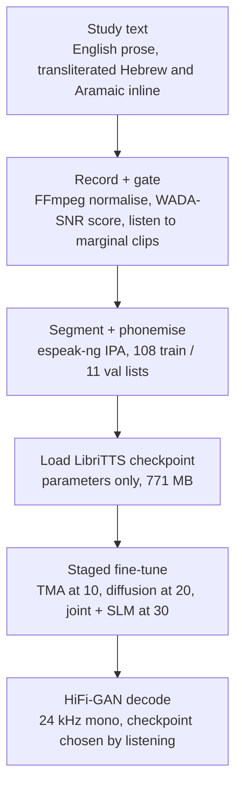

# Architecture

All values are from the fine-tune configuration in `code/configs/config_ft.yml` and the case study at https://digitb.tech/case-study/hebrew-tts/. The model code is the upstream StyleTTS 2 (https://github.com/yl4579/StyleTTS2, MIT), which is referenced, not copied.

## Data flow

## Components

| Component | Configuration | Reason |
|---|---|---|
| Mel front end | 24 kHz, n_fft 2048, win 1200, hop 300, 80 mels | Inherited from the pretrained checkpoint, changing it invalidates the decoder |
| PL-BERT | 12 layers, 768 hidden, 12 heads, 178-token phoneme vocabulary, 1M pretraining steps | Phoneme level, so loanwords are representable |
| Style diffusion | 3 transformer layers, 8 heads, 64 head-features, mask probability 0.1, sigma_data 0.2, style dim 128 | Samples style rather than fixing it |
| Duration predictor | max_dur 50, 3 layers, hidden 512 | Rhythm and pause length, most sensitive to bad segmentation |
| F0 / energy | JDC extractor, lambda_F0 1.0 | Without it the contour flattens within a few epochs |
| Aligner | ASR model, 80-mel input, 256 hidden, 178 tokens | Text/audio alignment, enters at epoch 10 |
| Decoder | HiFi-GAN, upsample rates 10, 5, 3, 2, initial channels 512 | Product is 300, equal to the mel hop |
| SLM discriminator | WavLM base+, 13 layers, 16 kHz | Adversarial naturalness signal |
| Optimiser | lr 1e-4, bert_lr 1e-5, ft_lr 1e-4, weight decay 1e-4 | PL-BERT is fine-tuned ten times slower on purpose |

## Staging schedule

| Epoch | Term enabled | Why |
|---|---|---|
| 0 | Mel, duration, F0, CE | Baseline acoustic fit |
| 10 | Monotonic alignment (TMA) | Nothing downstream means anything until text and audio align |
| 20 | Style diffusion | A meaningful style exists only once alignment is stable |
| 30 | Joint objective and SLM adversarial | Buys naturalness, destroys an unconverged model if it arrives early |

Loss weights: mel 5.0, CE 20.0, everything else 1.0. The CE weight keeps the duration predictor honest on a small corpus. SLM adversarial guard rails: 2% of batches, every 10 iterations, 400 to 500 frame sequences, scale 0.01, threshold 5, sig 1.5.
